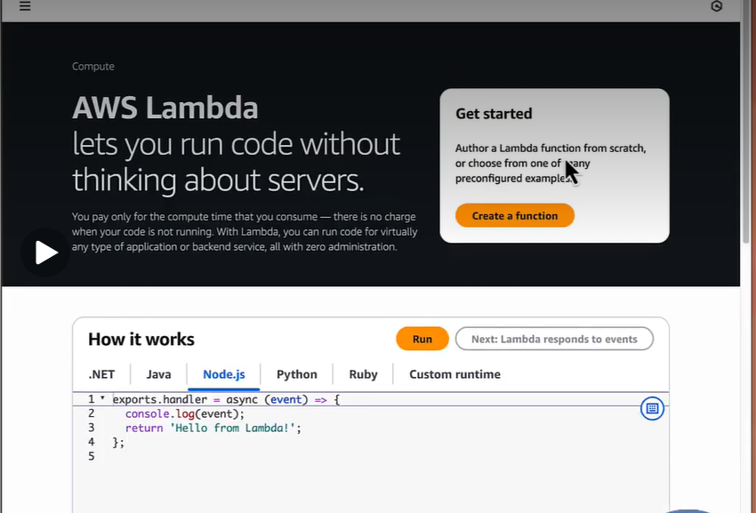
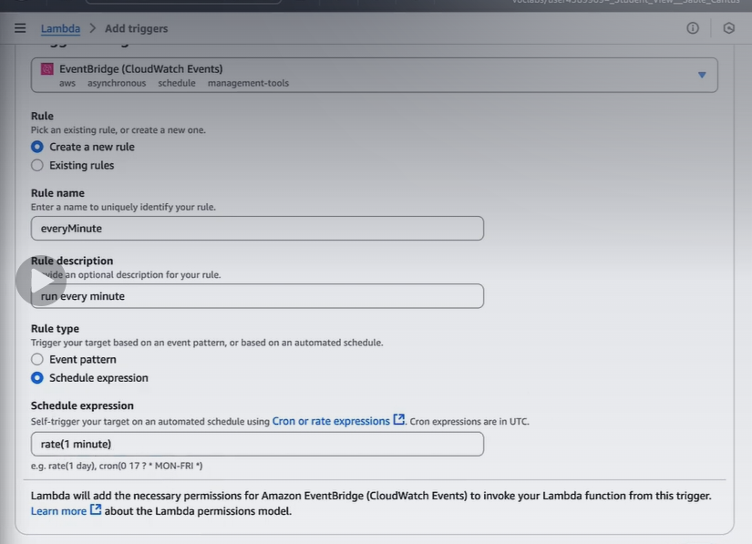
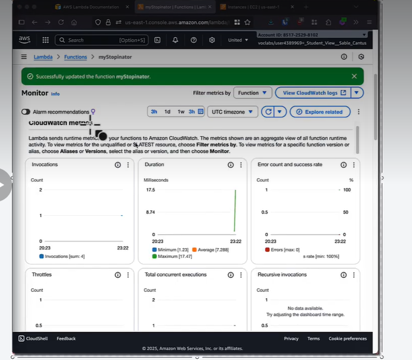

# Practical 8 — Serverless Function using AWS Lambda

**Aim:** To create and deploy a serverless function using AWS Lambda and execute
it on a schedule.

**Prerequisite:** An AWS account (free tier) or AWS Academy / Learner Lab
credentials.

> The code below stops EC2 instances. Use a test/sandbox account, or replace
> the body with a simple `print` if you have no EC2 instances.

---

## Create the function

1. Sign in to the AWS Management Console → open **Lambda**.
2. **Create a function**.
3. **Author from scratch**:
   - Function name: `myStopinato`
   - Runtime: **Python 3.x**
   - Architecture: x86_64
   - Permissions: create a new role with basic Lambda permissions
4. **Create function**.

## Add the schedule trigger

1. In the function page → **Add trigger**.
2. Source: **EventBridge (CloudWatch Events)**.
3. **Create a new rule**:
   - Rule name: `everyMinute`
   - Schedule expression: `rate(1 minute)`
4. **Add**.

## Write and deploy the code

Open the **Code** tab and replace the handler:

```python
import boto3

region = 'us-east-1'
instances = ['<REPLACE_WITH_INSTANCE_ID>']
ec2 = boto3.client('ec2', region_name=region)


def lambda_handler(event, context):
    ec2.stop_instances(InstanceIds=instances)
    print('stopped your instances: ' + str(instances))
```

> **No EC2 instance?** Use this safe version for the lab demo:

```python
def lambda_handler(event, context):
    print("Serverless function executed successfully")
    return {"statusCode": 200, "body": "OK"}
```

Click **Deploy**.

## Test it

1. **Test** tab → **Create new event** → name `TestEvent` → keep the default
   JSON → **Save**.
2. Click **Test**.
3. The execution result shows `statusCode: 200` (or the stop message) and the
   logs show the printed output.

## Monitor it

1. **Monitor** tab → view **Invocations**, **Duration**, **Error count**.
2. **View CloudWatch logs** → open the latest log stream → confirm the output.

The EventBridge rule also invokes the function every minute, so metrics appear
without manual tests.

## What to verify / screenshot

- [ ] Lambda home / function created
- [ ] Function overview with the EventBridge trigger
- [ ] Code source editor showing the handler
- [ ] Successful test execution
- [ ] Monitor tab metrics
- [ ] CloudWatch log output

Screenshots from the lab run are in
[`../screenshots/exp8/`](../screenshots/exp8/):





## Troubleshooting

| Problem | Fix |
|---|---|
| `AccessDenied` when stopping EC2 | Attach an IAM policy allowing `ec2:StopInstances` to the Lambda role |
| `InvalidInstanceID` | Replace the placeholder with a real instance ID in the same region |
| No invocations after 1 minute | Check the EventBridge rule is **Enabled** and the schedule is `rate(1 minute)` |
| Timeout | Increase the function timeout (Configuration → General configuration) |
| Cannot create function | Check the AWS region and IAM permissions; Academy labs restrict some services |

## Viva

- **What is serverless?** You run code without managing servers; the provider scales and bills per execution.
- **What is a handler?** The entry function Lambda calls: `lambda_handler(event, context)`.
- **What can trigger a Lambda?** API Gateway, S3, EventBridge schedules, queues, and more.
- **What is boto3?** The AWS SDK for Python used to call AWS services.
- **Why is Lambda cost-efficient for this task?** It runs only when triggered and you pay per invocation/duration.

**Result:** A serverless function was created, deployed, triggered on a schedule
through EventBridge and monitored with CloudWatch/CloudWatch metrics.
